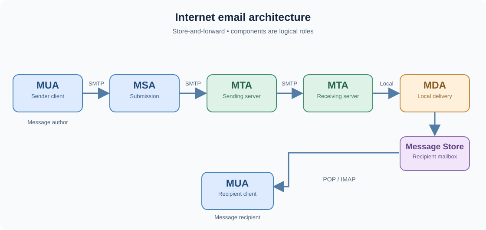

# Lecture 01 — Email Security

**Docente:** Leonardo Querzoni  
**Fonte:** `1 - Email security.pdf` (2026/27), slide **1–12**  
**Stato:** note delle parti studiate; spiegazioni aggiuntive esplicitamente indicate.

## Architettura e flusso (slide 1–6)

L'email usa un modello **store-and-forward**: i server memorizzano e inoltrano i messaggi; mittente e destinatario non devono essere online insieme.

| Componente | Funzione essenziale |
| --- | --- |
| **MUA** (*Mail User Agent*) | Client per comporre e leggere email |
| **MSA** (*Mail Submission Agent*) | Accetta il messaggio in uscita dal client |
| **MTA** (*Mail Transfer Agent*) | Trasferisce email fra server: può essere client e server SMTP |
| **MDA** (*Mail Delivery Agent*) | **Deposita** il messaggio nella mailbox del destinatario |
| **Message Store** | Conserva i messaggi consegnati |
| **MRA** (*Mail Retrieval Agent*) | **Recupera** i messaggi dalla mailbox per renderli disponibili al MUA |

**Flusso:** `MUA → MSA → MTA → [altri MTA] → MDA → mailbox → MRA → MUA`. Sono **ruoli logici**, non necessariamente sistemi separati; l'MRA può essere integrato nel MUA. **SMTP** invia/trasferisce, **POP3/IMAP** permettono l'accesso alla mailbox.

*Precisazione:* la slide 6 descrive MDA; MRA compare nel titolo. La spiegazione specifica dell'MRA è un'integrazione.

## SMTP: envelope ≠ message (slide 7–8)

SMTP (*Simple Mail Transfer Protocol*, RFC 5321) trasferisce email; il messaggio ha un **envelope SMTP** separato da **header e body** (formato RFC 5322).

| Envelope SMTP | Header del messaggio |
| --- | --- |
| `MAIL FROM`: indirizzo di ritorno per errori di consegna | `From:`: mittente **dichiarato**, normalmente visibile nel client |
| `RCPT TO`: destinatari effettivi della consegna | `To:`: destinatari **dichiarati**, visibili nel client |

**Esempio:** `MAIL FROM:<bounce@mailer.example>`, ma `From: Alice <alice@example.com>`. Possono coincidere oppure no. Anche se coincidono, **non costituiscono da soli una prova dell'identità** del mittente. I destinatari effettivi `RCPT TO` possono differire dal campo `To:` (ad esempio Bcc).

**Email spoofing:** un attaccante può inserire un `From:` ingannevole. È il problema di autenticazione che motiva SPF, DKIM e DMARC (da approfondire più avanti).

## Struttura dell'header (slide 9)

L'header è formato da campi `Nome: valore` (RFC 5322) ed è separato dal **body da una riga vuota**.

- **Folding:** un valore può proseguire sulla riga successiva se questa inizia con spazio o tab.
- Gli header tradizionali usano ASCII a 7 bit; **MIME encoded words** possono rappresentare valori non ASCII.
- **MIME** estende inoltre la rappresentazione del contenuto (allegati, media e codifiche).

## Due identificatori diversi (slide 10–11)

| | **Message-ID** | **ENVID** |
| --- | --- | --- |
| A cosa si riferisce | Al messaggio | A una singola operazione di invio/consegna |
| Dove si trova | Campo dell'**header** | Identificatore dell'**envelope** SMTP |
| Assegnato da | MUA o MSA | Primo MTA (come indicato nella slide) |
| Utilità | Thread, duplicati, tracking | Tracciare un ciclo di consegna e le notifiche relative |

**Message-ID**, es. `<20241001102233.12345@example.com>`: il dominio dopo `@` identifica chi assegna l'ID; la parte prima di `@` identifica il messaggio in quell'ambito. È progettato per essere globalmente unico, **non è una prova di autenticità**.

**ENVID** (*Envelope Identifier*): identifica una **specifica operazione di invio e consegna**, non il messaggio in sé. Nel normale trasferimento `MTA 1 → MTA 2 → MTA 3` non viene rigenerato a ogni passaggio; neppure un semplice nuovo tentativo dopo un errore temporaneo costituisce automaticamente un nuovo *posting*. Se invece un sistema **re-immette il messaggio come nuova spedizione** (*re-posting*, per esempio una mailing list che lo redistribuisce), **non riutilizza l'ENVID precedente**, anche se il contenuto resta uguale.

*Precisazione tecnica esterna:* ENVID è un parametro **opzionale** dell'estensione SMTP DSN (RFC 3461), quindi non tutte le email lo usano. Il suo scopo è associare le notifiche di consegna alla corretta operazione di invio; il re-posting è distinto dal semplice inoltro tra MTA.

## Campi e destinatari effettivi (slide 12)

La slide cita `From:`, `To:`, `Date:`, `Message-ID:`, `Subject:` e li presenta come obbligatori. **Attenzione rispetto allo standard:** nella RFC 5322 non tutti lo sono (per esempio `Subject:` è facoltativo).

**Idea chiave della slide:** `To:` non determina necessariamente a chi SMTP consegna il messaggio; è `RCPT TO` a specificarlo. Analogamente, `From:` non prova chi abbia realmente inviato l'email.

## Da saper spiegare senza appunti

Perché **MDA** e **MRA** svolgono compiti diversi? Quale differenza esiste fra `MAIL FROM` e `From:`? Perché un `Message-ID` con un dominio apparentemente affidabile non autentica il messaggio?
